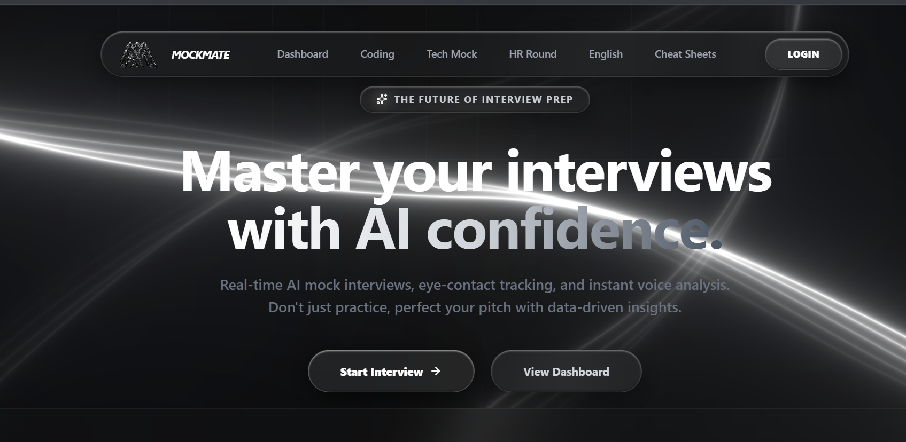
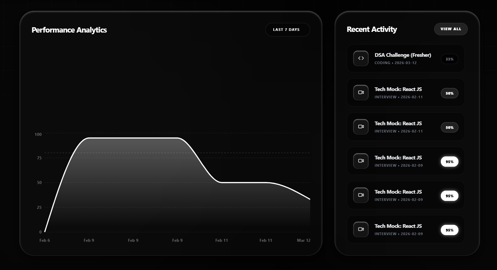
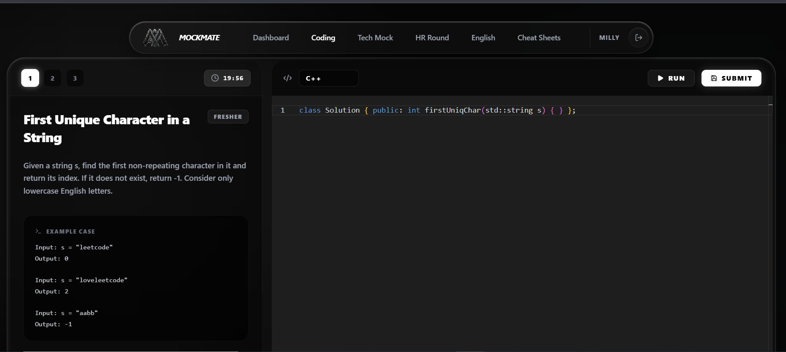
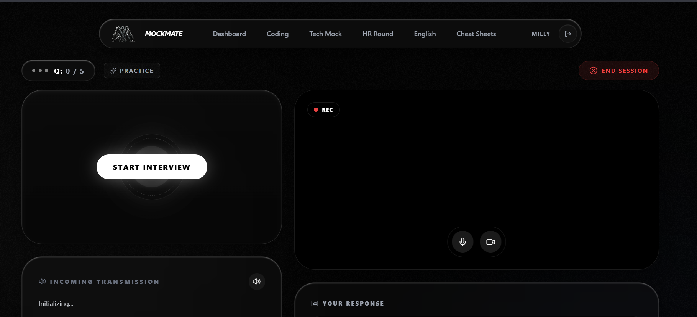

# 🤖 AI MockMate – An AI-Powered Interview Preparation Platform

<p align="center">
  **Prepare Smarter. Practice Better. Interview Confidently.**
</p>

AI MockMate is an AI-powered interview preparation platform designed to help students and developers improve their interview skills through interactive mock interviews, personalized practice, and structured technical resources.

The platform provides dedicated modules for **Technical Interviews, HR Interviews, and Cheat Sheets**, enabling users to practice interview scenarios, strengthen their technical knowledge, and build confidence before real-world interviews.

---

## ✨ Key Features

- **🎯 Technical Interviews:** Practice technical interview questions through dynamic AI-powered interview simulations.
- **💬 HR Interview Preparation:** Improve communication skills and prepare for commonly asked HR questions.
- **📚 Cheat Sheets:** Access structured technical resources for quick revision and interview preparation.
- **🤖 AI-Powered Interaction:** Experience dynamic interview simulations with AI-generated questions and responses.
- **📈 Interview Preparation:** Strengthen problem-solving, technical knowledge, and overall interview readiness.
- **🖥️ Interactive UI:** A clean and user-friendly interface for a seamless preparation experience.

## 📸 Project Screenshots

### 🏠 Home Page
<p align="center">
  
</p>

### 📊 Dashboard
<p align="center">
  
</p>

### 💻 Coding Preparation
<p align="center">
  
</p>

### 🎤 AI Mock Interview
<p align="center">
  
</p>

## 🛠️ Tech Stack

<!-- Update this section with your actual technologies -->

| Category | Technologies |
|---|---|
| Frontend | React.js,Framer Motion, Monaco Editor, Recharts|
| Backend | Pyhton, Fast Api |
| Database | Mongodb |
| AI Integration | Google Gemini API |
| Authentication | JWT |
| Deployment | Vercel |

## ⚙️ Getting Started

Follow these steps to run the project locally.

### 1. Clone the Repository

```bash
git clone https://github.com/millyjain09/AI-MockMate.git
cd AI-MockMate
```

### 2. Install Dependencies

Install the dependencies for your frontend and backend according to your project structure.

```bash
npm install
```

### 3. Configure Environment Variables

Create a `.env` file in the appropriate directory and configure the required environment variables.

```env
PORT=5000
# Add your database connection string
# Add your AI API key
# Add your authentication secrets
```

Never commit API keys, credentials, or other sensitive information to GitHub.

### 4. Run the Application

```bash
npm run dev
```

Use the appropriate commands for your frontend and backend if they run separately.

## 🎯 Project Objectives

- Make interview preparation more interactive and accessible.
- Help students prepare for technical and HR interviews.
- Provide structured resources for quick technical revision.
- Use AI to create dynamic and engaging interview practice experiences.
- Help candidates build confidence and improve interview readiness.

## 🔮 Future Enhancements

- Detailed interview performance analytics.
- Personalized AI-powered improvement recommendations.
- More interview categories and difficulty levels.
- Interview history and progress tracking.
- Enhanced feedback and evaluation mechanisms.

## 👩‍💻 Author

**Milly Jain**

B.Tech Computer Science & Engineering

- GitHub: [@millyjain09](https://github.com/millyjain09)
- LinkedIn: [Milly Jain](https://linkedin.com/in/milly-jain/)

---

<p align="center">
  **Built with ❤️ to make interview preparation smarter.**
  <br/>
  <i>Practice. Improve. Get Interview Ready.</i>
</p>
